# Pillr — what changed, up close

P0 from [AUDIT_AND_PLAN.md](./AUDIT_AND_PLAN.md), shot the way Wave documented theirs: one metric, one law, before / after. Full-page live shots were not taken against production; these are the real Seline components, with Inter loaded, captured from `test/ux_audit/gallery_test.dart` on the local tree. Before lives in `screenshots/before/`. After lives in `screenshots/after/`.

---

## Keyboard focus and text contrast

Focus was a 2px cyan border flush on the field — easy to miss, and cyan on white is about **2.6:1**. Helper copy and captions sat on `Sel.ash` `#A8A29E` at about **2.4:1**. Now a **2px ink ring, offset 2px**, wraps the focused field (ink is ~19:1). Captions, chevrons, and field icons moved to `Sel.warm` `#78716C` at about **4.6:1**, which clears WCAG AA.

**Laws:** Jakob’s Law (focus looks like a focus ring), Selective Attention, Working Memory.

<table>
<tr>
<th width="50%">BEFORE</th>
<th width="50%">AFTER</th>
</tr>
<tr>
<td>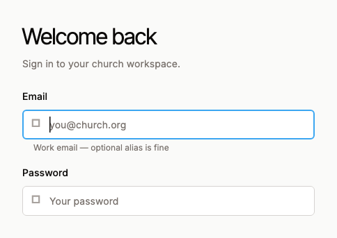</td>
<td>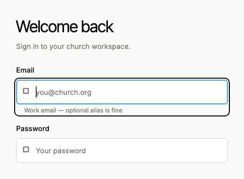</td>
</tr>
</table>

---

## Queue status pills

Pills were **~28px** in a filter row — the worst regular target after icon buttons. They are now **44px**. Same soot-filled active state, same rail. Fitts’s Law: time to a target is a function of distance and size; a thumb or a hurried mouse needs the extra 16px.

**Laws:** Fitts’s Law, Hick’s Law (same four choices, easier to hit).

<table>
<tr>
<th width="50%">BEFORE</th>
<th width="50%">AFTER</th>
</tr>
<tr>
<td>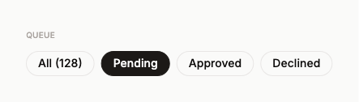</td>
<td>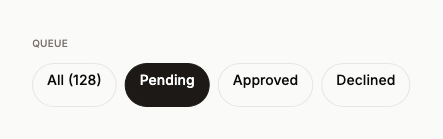</td>
</tr>
</table>

---

## Primary actions and icon buttons

`SelButton` was **34px** (dense 28). Search and bell were **32×32**. They are now **44px**, with the same cyan / ghost / quiet hierarchy. Icon-only controls are a 44×44 square so the badge still sits on the shoulder without shrinking the hit area.

**Laws:** Fitts’s Law, Pareto (New entry, Approve, Search are the 20%).

<table>
<tr>
<th width="50%">BEFORE</th>
<th width="50%">AFTER</th>
</tr>
<tr>
<td>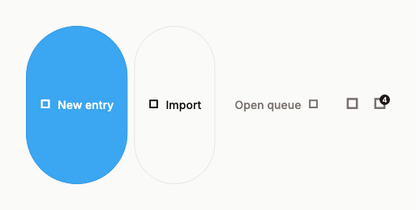</td>
<td>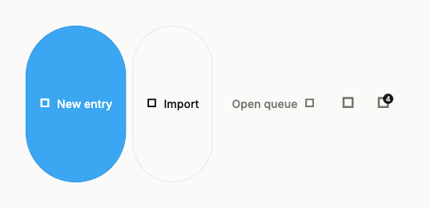</td>
</tr>
</table>

---

## Overview stats — caption contrast

Stat labels used `SelType.caption` in ash (**~2.4:1**). They now use warm (**~4.6:1**). The tiles themselves were already a good chunk (four KPIs). This is the same move Wave made on “optional” helper text.

**Laws:** Aesthetic-Usability Effect (pretty and readable), Working Memory.

<table>
<tr>
<th width="50%">BEFORE</th>
<th width="50%">AFTER</th>
</tr>
<tr>
<td>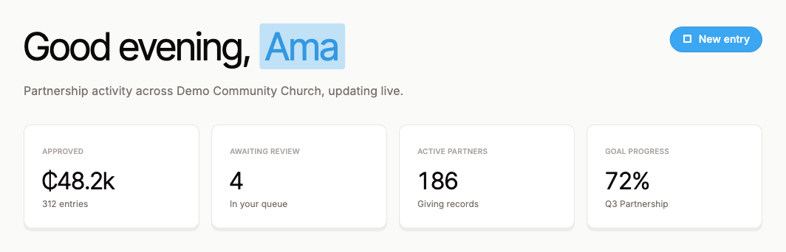</td>
<td>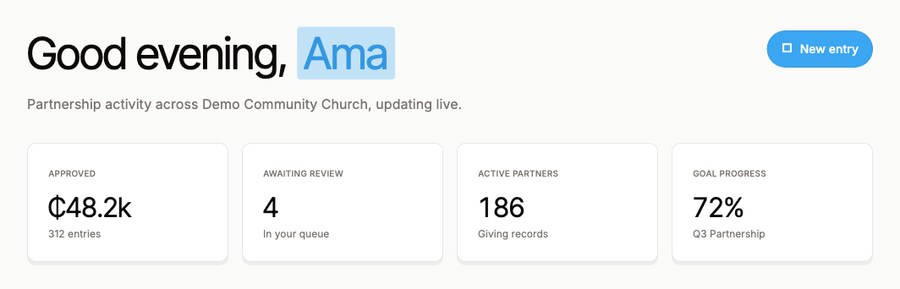</td>
</tr>
</table>

---

## Waiting on you — isolation

The pending panel was another white card, identical to Recent activity. The open loop was only in the title. It now has a **3px ochre edge** and copy that says the queue is still open: “4 entries still open — the queue is waiting.”

**Laws:** Von Restorff (the different thing is remembered), Zeigarnik (unfinished work stays in mind), Uniform Connectedness.

<table>
<tr>
<th width="50%">BEFORE</th>
<th width="50%">AFTER</th>
</tr>
<tr>
<td>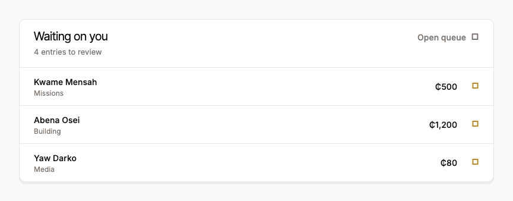</td>
<td>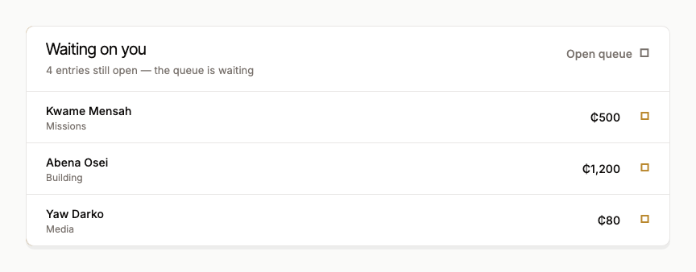</td>
</tr>
</table>

---

## Goals — remaining distance

The bar was **4px**. Copy stopped at “₵14,400 of ₵20,000.” The bar is now **8px**, and an open goal adds **“28% to go.”** Goal-gradient: people move faster when they can see the last stretch.

**Laws:** Goal-Gradient Effect, Zeigarnik, Selective Attention.

<table>
<tr>
<th width="50%">BEFORE</th>
<th width="50%">AFTER</th>
</tr>
<tr>
<td>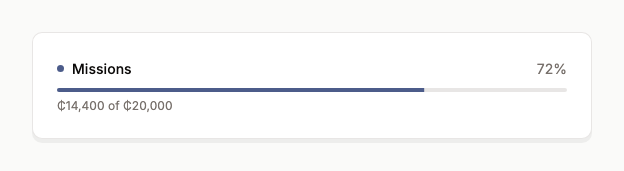</td>
<td>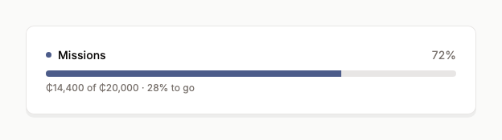</td>
</tr>
</table>

---

## Filter chips and chevrons

Records chips were **~32px** with 11px ash chevrons (**~2.4:1**). They are **44px**, chevrons and dismiss icons are **warm** (**~4.6:1** / **>3:1** for UI). Same two-filter cap — Hick’s was already done here; this is Fitts and contrast.

**Laws:** Fitts’s Law, Working Memory.

<table>
<tr>
<th width="50%">BEFORE</th>
<th width="50%">AFTER</th>
</tr>
<tr>
<td>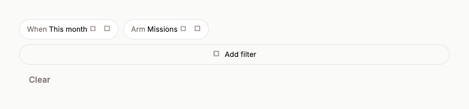</td>
<td>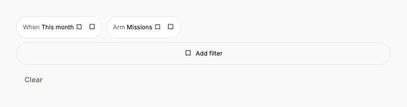</td>
</tr>
</table>

---

## Account chip

The signed-in cluster was a **~30px** pill with an ash chevron. It is **44px** tall; the chevron is warm. Settings still live in this menu, which is why Settings left the mobile bar (five destinations, not six).

**Laws:** Fitts’s Law, Jakob’s Law, Hick’s Law / Miller’s Law (mobile bar).

<table>
<tr>
<th width="50%">BEFORE</th>
<th width="50%">AFTER</th>
</tr>
<tr>
<td>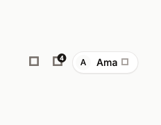</td>
<td>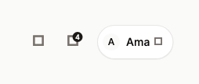</td>
</tr>
</table>

---

## What else shipped without a dedicated frame

| Change | Law | Where |
|---|---|---|
| Rail rows **44px**, keyboard-focusable, inactive children in warm not ash | Fitts, Jakob, contrast | `sel_rail.dart` |
| Popup / account menu items **44px** | Fitts | `sel_shell.dart`, `record_filter_bar.dart` |
| Pastor / staff mobile bar **6 → 5** (Settings via account) | Hick, Miller, Serial Position | `nav_model.dart` |
| Fields **~44px** tall | Fitts | `seline_theme.dart`, `sel_field.dart` |
| Tappable cards take keyboard focus | Jakob | `sel_card.dart` |
| `SelLayout.tapTarget = 44`, `tapTargetDense = 36` | Fitts | `seline_metrics.dart` |

---

## How to recapture

```bash
# Restore the previous design system first if you need a true before.
UX_AUDIT_PHASE=before flutter test --update-goldens test/ux_audit/gallery_test.dart
UX_AUDIT_PHASE=after  flutter test --update-goldens test/ux_audit/gallery_test.dart
```

Without `UX_AUDIT_PHASE`, the gallery test is a no-op so `flutter test` stays green.

---

## Not done in this pass (see the plan)

Entry-form progressive disclosure, liberal amount parse, queue pill region, Peak-End on approve, Doherty deciding-state on rows. Those are P1 in the audit.
